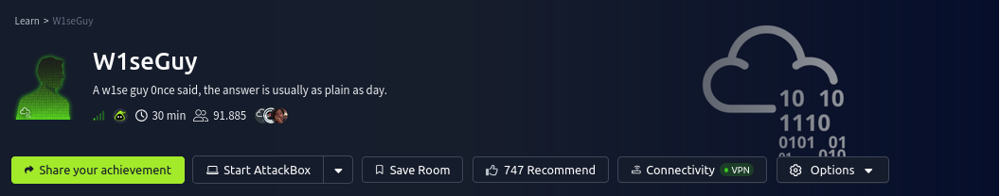
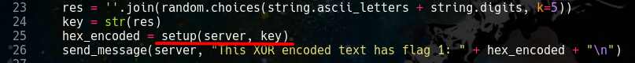
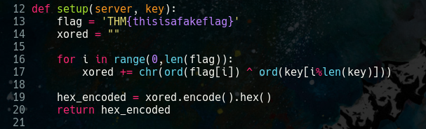
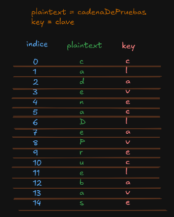
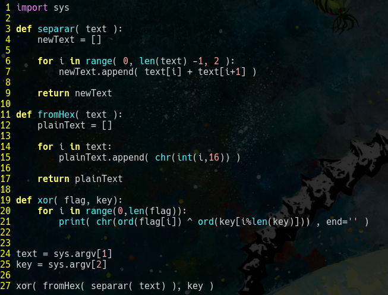
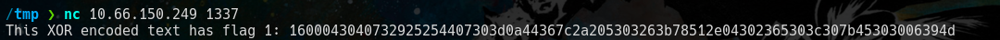
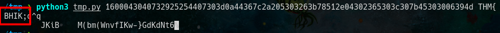
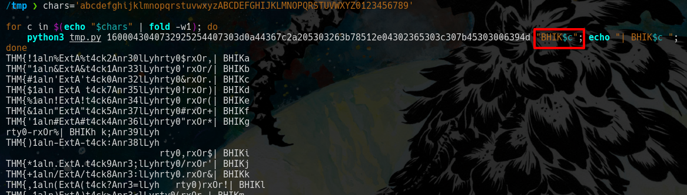
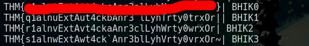
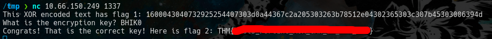

# Contexto
Yes, it's me again with another crypto challenge!

Have a look at the source code before moving on to Task 2.

You can review the source code by clicking on the Download Task Files button at the top of this task to download the required file.

# Preguntas
- What is the first flag?
- What is the second and final flag?

# Solucion
Entonces primero descargamos los archivos que comenta el contexto y es un archivo '.py'

## Archivo python
El archivo nos muestra como se comparte el servicio y lo mas importante como se cifra la primera bandera.

En este caso es un cifrado **xor** el cual necesita una **key** y un **plainText** (un texto a cifrar) para producir un texto cifrado.

Entonces recordemos **'un key y un plainText'** produce el **'cipherText'**, pero el cifrado xor permite recuperar la **key** si combinamos **un cipherText y un plainText**

Para mas contexto de xor revisa: https://es.wikipedia.org/wiki/Cifrado_XOR

Regresemos al archivo esta parte genera la **Key** y la pasa a la funcion **setup**.

Esta funcion hace posible el cifrado xor.

Notemos que la *key* se genera con una longitud de 5 caracteres que incluye letras y numeros que se generan de manera aleatoria.

Tambien notemos que en la funcion cifra el plaintext caracter a caracter con la key de esta manera.

Es decir la los caracteres de la key se van a usar en distintas partes del plaintext gracias a esta parte del codigo '**key[i%len(key)]**'.

## script python
Antes de usar explotar el xor necesitamos formatear el texto que nos envia el servidor, ya que este se envia en hexadecimal, las funciones **separar y fromHex** se encargan de eso.

vamos a tratar de adivinar la flag, recordemos que las flags en tryhackme empieza por 'THM{' asi que usaremos eso para descubrir parte de la key.

Obtenemos parte de la key **'BHIK'** pero nos falta un caracter ya que el script nos dice que la key debe ser de 5 caracteres asi que aplicamos fuerza bruta para descubrir ese caracter.

## Respuesta a 'What is the first flag?'

De los resultados despues de aplicar fuerza bruta nos interesa el que termina con **'}'** ya que asi terminan las flag's.

## Respuesta a 'What is the second and final flag?'
Enviamos la key que descubrimos al servidor y nos da la 2 flag. 

